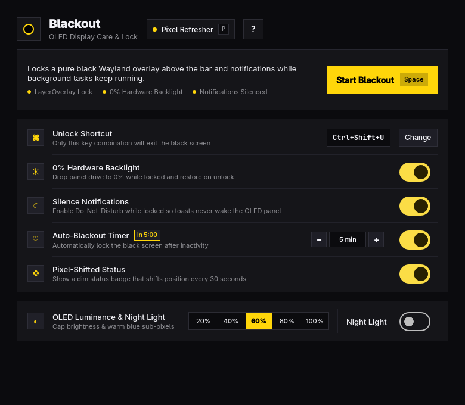

# Blackout



**Blackout** is an Apple HIG-styled OLED screen curtain, key-combo lock, and OLED care utility for Linux (Wayland / Hyprland / Omarchy) and Windows (10 / 11).

When you walk away while running tasks on your laptop, Blackout completely blacks out the display with a topmost zero-nit curtain, drops hardware panel brightness to `0%`, silences notifications, and inhibits system sleep so long-running computations (renders, compiles, downloads, models) run unhindered while keeping your OLED panel protected.

---

## Features

- **Topmost Zero-Nit Screen Curtain**:
  - **Linux (Wayland)**: Runs on `LayerShellQt::Window::LayerOverlay` with `exclusiveZone = -1` and `KeyboardInteractivityExclusive`—immune to workspace tiling, floating windows, or top-bar reservations.
  - **Windows**: Spans all monitors as a frameless `HWND_TOPMOST` curtain covering taskbar and action center toasts.
- **Background Task Protection (No Sleep)**:
  - **Linux**: Inhibits idle and system suspend through systemd-logind (`org.freedesktop.login1`) and ScreenSaver D-Bus.
  - **Windows**: Activates `SetThreadExecutionState(ES_CONTINUOUS | ES_SYSTEM_REQUIRED | ES_AWAYMODE_REQUIRED)` so the screen remains off while background processes run at full performance.
- **0% Hardware Backlight Cut**:
  - Drops hardware backlight to `0%` during blackout (`brightnessctl` / `/sys/class/backlight` on Linux, WMI `WmiMonitorBrightnessMethods` on Windows).
  - Flashes at `5%` for 1.6s if a wrong key is pressed so you can see the unlock hint, and smoothly restores prior brightness on unlock.
- **Automatic Notification Silencing (DND)**:
  - Silences toasts while locked (`omarchy-shell notifications setDnd on` on Linux, Windows Notification Settings on Windows) so incoming alerts never illuminate OLED pixels.
- **Key-Combo Lock**:
  - Swallows single keys, Escape, Space, Q, and mouse clicks while active—exits only when your exact unlock shortcut (default `Ctrl+Shift+U`) is entered.
- **OLED Luminance Presets & Warm Night Light**:
  - Apple HIG segmented control presets (`20%`–`100%`) to cap OLED luminance during work sessions.
  - Live toggle for warm Night Light to reduce blue sub-pixel wear.
- **OLED Pixel Refresher**:
  - Built-in 60-second rolling wash bar + RGB/CMY sub-pixel leveling sweep (`P`) to clear temporary image retention.
- **Headless CLI & Agent Skill**:
  - Inspect state, run checks, and modify settings via `blackout status --json`, `blackout check --json`, `blackout set ... --json`, and `blackout skill install`.

---

## Keyboard Shortcuts

| Key | Action |
|-----|--------|
| `Space` | Start OLED blackout |
| `Ctrl+Shift+U` | Default unlock key combo (configurable) |
| `R` | Record a new unlock key combo |
| `Backspace` | Reset unlock key combo to `Ctrl+Shift+U` |
| `B` | Toggle 0% hardware backlight cut during blackout |
| `D` | Toggle notification silencing (DND) during blackout |
| `A` | Toggle auto-blackout inactivity timer |
| `-` / `+` | Decrease / increase inactivity timeout minutes |
| `I` | Toggle pixel-shifted status badge |
| `1` – `5` | Set OLED brightness preset (`20%`, `40%`, `60%`, `80%`, `100%`) |
| `N` | Toggle warm Night Light (`4000K`) |
| `P` | Run 60-second OLED Pixel Refresher |
| `Ctrl+Z` / `Ctrl+Shift+Z` | Undo / Redo setting change |
| `?` | Show / hide keyboard shortcuts |
| `Q` | Quit (disabled while blackout is locked) |

---

## CLI Commands

```sh
blackout open                                  # Open the GUI window
blackout lock --quit-on-unlock                 # Immediately enter locked OLED blackout
blackout status --json                         # Print current settings and hardware state
blackout check --json                          # Check required tools and backlight sysfs
blackout set --unlock Ctrl+Alt+U --auto on     # Update settings headlessly
blackout skill install                         # Install the agent skill
```

---

## Installation & Build

### Linux (Arch Linux / Omarchy)

```sh
./bin/build
./bin/test
./bin/install
```

### Windows (10 / 11)

Download the pre-built `blackout-windows-x64.zip` from [GitHub Releases](https://github.com/naseebnaushad/blackout/releases), extract it, and run `blackout.exe`.

To build from source on Windows with Qt 6:

```cmd
qmake blackout.pro "CONFIG+=release"
nmake release
windeployqt --qmldir src --release release\blackout.exe
```
